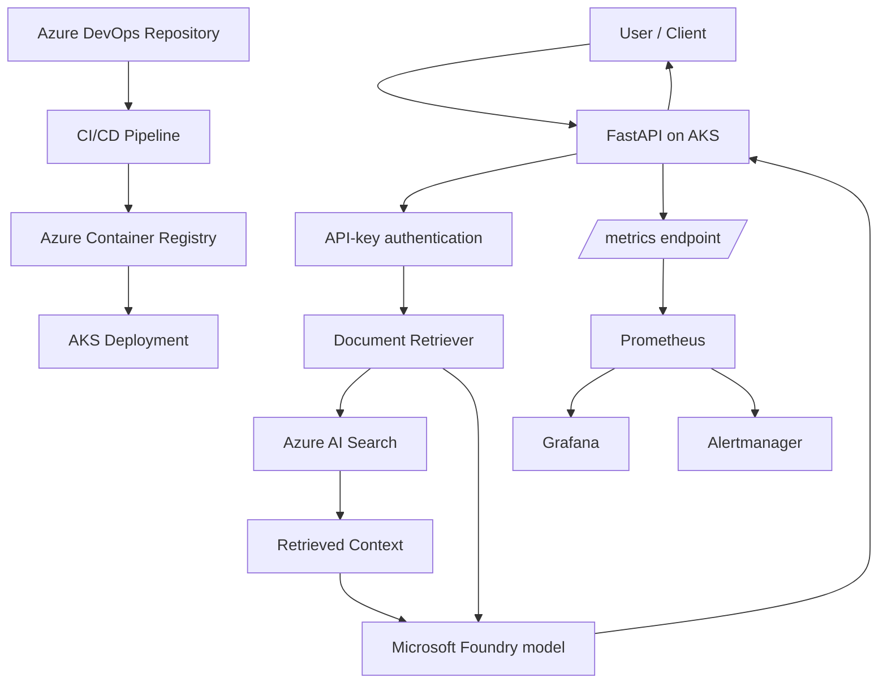

# SentinelRAG — Azure-Native Retrieval-Augmented Generation

SentinelRAG is a cloud-hosted Retrieval-Augmented Generation (RAG) application that retrieves relevant technical knowledge from Azure AI Search and uses Microsoft Foundry to generate grounded answers. It runs on Azure Kubernetes Service (AKS) and includes CI/CD, monitoring, alerting, and evaluation tooling.

## Project Objectives

- Build a RAG application with searchable technical documentation.
- Generate answers grounded in retrieved knowledge.
- Deploy the API on Azure Kubernetes Service.
- Automate container build and deployment through Azure DevOps.
- Monitor API availability and server errors with Prometheus, Grafana, and Alertmanager.
- Evaluate retrieval quality and answer generation.

## Architecture



## Technology Stack

- **Application:** Python, FastAPI
- **RAG and retrieval:** Azure AI Search, vector search, embeddings
- **Model inference:** Microsoft Foundry
- **Containers:** Docker, Azure Container Registry
- **Orchestration:** Azure Kubernetes Service
- **CI/CD:** Azure DevOps Pipelines
- **Infrastructure as Code:** Terraform
- **Monitoring and alerting:** Prometheus, Grafana, Alertmanager
- **Identity and secrets:** Azure managed identity, Azure Key Vault

## Current Evaluation Results

Latest recorded local evaluation results:

| Metric | Result |
|---|---:|
| Retrieval questions | 10 |
| Retrieval hit rate | 100% |
| Hit@1 | 90% |
| Hit@3 | 100% |
| Hit@5 | 100% |
| Mean Reciprocal Rank (MRR) | 0.95 |
| Generation questions | 10 |
| Generation pass rate | 90% |

These results are from a small evaluation dataset and are not a guarantee of performance on all questions.

## Azure Resources

The development environment includes:

- Resource group: `rg-sentinelrag-dev`
- AKS cluster: `aks-sentinelrag-dev`
- Container registry: `sentinelragacr`
- Azure AI Search: `search-sentinelrag-dev`
- Key Vault: `kv-sentinelrag-dev-01`
- Microsoft Foundry resource: `sentinelrag-ai-boundary`

Resource availability and costs depend on the current Azure subscription and configuration.

## Local Setup

Prerequisites:

- Python and a virtual environment
- Azure CLI authenticated to the correct subscription
- Access to the configured Azure AI Search and Microsoft Foundry resources
- Required environment variables configured locally

Create and activate a virtual environment, then install the project dependencies:

```bash
python3 -m venv .venv
source .venv/bin/activate
pip install -r requirements.txt
```

Configure the environment variables required by the application and evaluation scripts. Use your local environment file or approved secret store; do not commit credentials.

The application and evaluation scripts use Azure identity credentials and configured service endpoints. Check the source code and environment configuration for the exact required variable names before running them.

## Evaluation

Run retrieval evaluation from the repository root:

```bash
PYTHONPATH=. python app/evaluate_rag.py
```

Run answer-generation evaluation:

```bash
PYTHONPATH=. python app/evaluate_generation.py
```

Generation evaluation invokes the configured model and may incur usage charges.

## Kubernetes Verification

Check the deployment and pods:

```bash
kubectl get deployment sentinelrag-api
kubectl get pods -n default
```

Check the health endpoint using your current API endpoint:

```bash
curl -i http://<API-ENDPOINT>/health
```

The health endpoint previously returned HTTP 200 with a healthy status.


## Documentation

- [Kubernetes deployment guide](docs/kubernetes.md)
- [Troubleshooting guide](docs/troubleshooting.md)
- [Knowledge base](docs/knowledge/)

## Monitoring

The local monitoring stack is defined in `monitoring/compose.yaml`.

Start the monitoring services:

```bash
docker compose -f monitoring/compose.yaml up -d
```

Inspect service status:

```bash
docker compose -f monitoring/compose.yaml ps
```

Local interfaces:

- Prometheus: http://localhost:9090
- Grafana: http://localhost:3000
- Alertmanager: http://localhost:9093

The Prometheus configuration monitors the API metrics endpoint and Prometheus itself. Alert rules include API availability and high server-error rate.

Monitoring services run on localhost-bound ports in the current development configuration. Keep notification credentials and runtime secret files out of Git.

## Terraform

The Terraform configuration is located in `infra/terraform/`. It describes selected existing resources, including Azure Container Registry, Azure AI Search, and Key Vault.

Validate the configuration:

```bash
terraform -chdir=infra/terraform init
terraform -chdir=infra/terraform validate
terraform -chdir=infra/terraform plan \
  -var="subscription_id=$(az account show --query id -o tsv)"
```

The current setup uses local Terraform state. State files can contain sensitive information and must not be committed. A local state file is required to reliably plan changes against resources that have already been imported.

Review every plan before applying it. Do not run `terraform apply` unless you understand the proposed changes.

## Security Considerations

- The API rejects requests with a missing or invalid API key.
- Do not commit API keys, credentials, `.env` files, Terraform state, or monitoring secrets.
- The current public API endpoint uses HTTP rather than HTTPS. Use HTTPS and appropriate network restrictions before exposing the application to production users.
- Apply least-privilege Azure roles and managed identities.
- Restrict access to Azure AI Search, Key Vault, container registry, and monitoring interfaces.
- Validate authorization, TLS, logging, and secret-handling requirements before production use.

## Cost Management

Azure resources may continue to incur charges even when AKS is stopped. In particular, review Azure AI Search, container registry, networking, AI model usage, and other provisioned services in the Azure portal.

Stop AKS when you do not need the live demo:

```bash
az aks stop \
  --resource-group rg-sentinelrag-dev \
  --name aks-sentinelrag-dev
```

Start it again when required:

```bash
az aks start \
  --resource-group rg-sentinelrag-dev \
  --name aks-sentinelrag-dev
```

Check current resource usage and billing in the Azure portal. Stopping AKS does not stop all charges.

## Current Project Status

The development environment has demonstrated successful API health checks, API-key rejection for unauthenticated requests, successful Prometheus scraping, loaded alert rules, and retrieval and generation evaluations.

This is a development and portfolio demonstration. Production readiness requires additional security hardening, HTTPS, operational validation, and documented recovery procedures.
